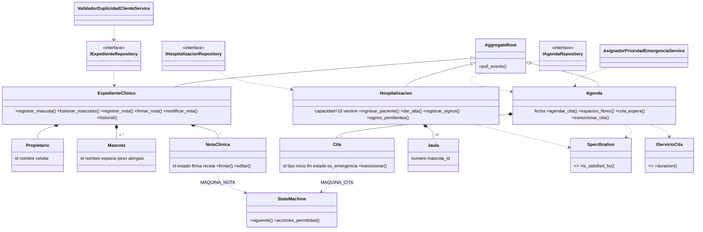
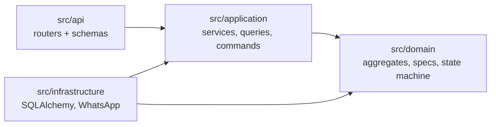
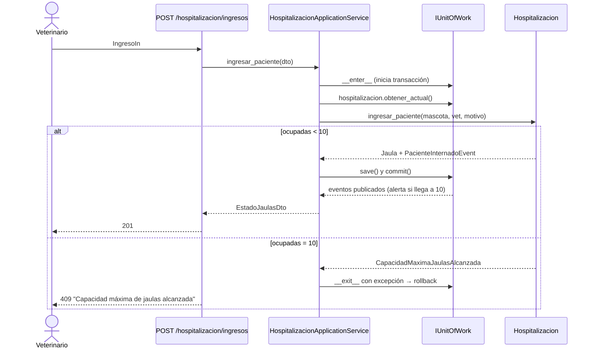
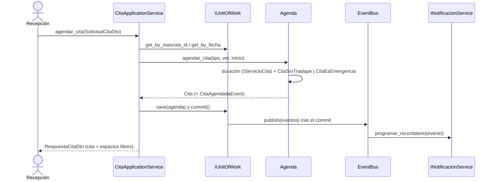

# Diagramas UML

## Diagramas de diseño (Actividad 3)
Diseño original previo a la implementación, en [`diagrams/`](diagrams/):

| Archivo | Contenido |
|---------|-----------|
| `mapa_dominio.png` | Mapa de dominio: 3 agregados, Value Objects, Domain Services y Domain Events |
| `clases_act3.png` | Clases por capas (Dominio / Aplicación / Infraestructura) |
| `secuencia_cu01_agendar_cita.png` / `.mmd` | CU-01, flujo principal (N-001) |
| `secuencia_cu04_ingreso_hospitalizacion.png` / `.mmd` | CU-04, flujo con rechazo y rollback (BR-002) |

> **Evolución diseño → código.** El diseño de la Act. 3 hablaba de repositorios «JPA»; la implementación usa **SQLAlchemy** (`SqlXRepository`) bajo los mismos puertos (`IXRepository`). Además, el PIA añadió la State Machine (`MAQUINA_CITA`, `MAQUINA_NOTA`), Specifications compuestas, versionado optimista en `Hospitalizacion` (ADR-004) y `IVeterinarioRepository`. Los diagramas Mermaid de abajo reflejan **el código final**.
Los siguientes diagramas (Mermaid, se renderizan en GitHub) reflejan **el código implementado**.

## Clases (dominio + puertos)

## Capas y dependencias

## Secuencia CU-04: ingreso a hospitalización con rechazo

## Secuencia CU-01: agendar cita

